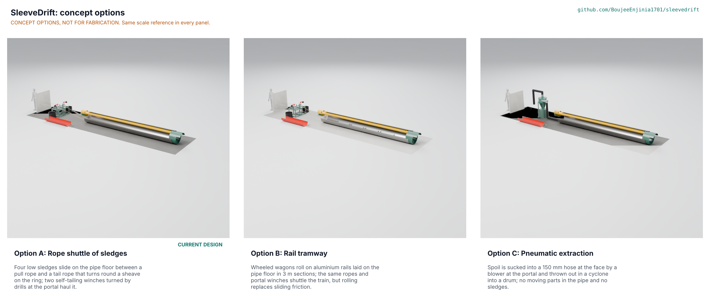

# SleeveDrift concept options

Option A (the rope shuttle of sledges, the current design) scores 175 of 195, option B (rail tramway) 164 and option C (pneumatic extraction) 148. A leads B by 6.3 %, which is inside the 10 % band, so **both A and B go to Amish with no pick** (STANDARDS section 21); C is 15.4 % behind A. **Proposed, awaiting Amish** (SVD-DDR-005, SVD-DEC-001 open decision 1). Option A stays the baseline until Amish decides; nothing was redesigned.

> **Safety:** All three options are for use inside a rescue pipe under collapse debris. Scores and first-order numbers are paper estimates, not test results, and no option is certified rescue, mining or confined-space equipment.

*Figure 1. The three options modelled at the same scale (rendered from the D3 models in `cad/src/model.py` by `python .kit/options.py` on Amish's Mac).*

## The options

### Option A: rope shuttle of sledges (current design)

Four low sledges slide on the pipe floor between a pull rope and a tail rope that turns round a sheave on the hooded ring at the face. Two self-tailing winches on welded trestles at the portal, each turned by a right-angle drill, haul the train: 0.42 m3/h, 93 N at the handle by hand at the start, a rope factor of 6.5 on a 2.5 kN breakaway swivel. Nothing powered goes in the pipe. Key risk: rope wear over 72 hours (STM S15, managed by inspection and a spare set) and the sliding friction of the runners on a gritty floor (STM S16).

### Option B: rail tramway

The same hooded ring, ropes, winches and portal station, but the sledges are replaced by four wheeled wagons on 40 x 40 x 4 mm aluminium T rails laid in 3 m sections on sleepers on the pipe floor. Rolling replaces sliding: the rope pull is 162 N against 790 N (STM O2) and the rail carries a wheel load at 8.1 MPa against 240 MPa yield (STM O1). By hand it makes 0.28 m3/h, only just above the Silkyara face rate of 0.27 m3/h (STM O5). Key risk: laying and levelling 60 m of rail in a pipe with debris and wet clay, and rail sections that jam when the pipe is pushed forward. Needs a co-design partner to say whether crews will accept rails in the pipe.

### Option C: pneumatic extraction

No sledges and no ropes: spoil is sucked into a 150 mm hose at the face by a blower at the portal and thrown out in a cyclone into a drum, with a filter on the exhaust. The first draft, a 2.2 kW fan carrying 50 mm rubble, failed the STEM check (it needs about 2.4 kW for 6 mm fines and 17 kW for 50 mm at 1.5 times the terminal velocity). The fix under the standing instruction keeps the principle: a 7.5 kW three-phase high-pressure blower on a portal generator, with lumps limited to 12 mm by the crew feeding the nozzle by hand (SVD-DEC-001 D1; STM O4, plausible: it needs about 1,200 m3/h at about 1.9 kPa from a named blower curve, to assess). Rubble above 12 mm would need a suction-excavator class plant of tens of kW, which is not a portable kit. Key risks: a blocked hose, hose abrasion, generator exhaust drawn into the intake at the portal, and no casualty route (a casualty cannot be pulled out by this option; a separate rope and winch would be needed). A grid at the nozzle mouth is the obvious hardware for the 12 mm limit and is not modelled.

Not re-proposed: a circulating loop, a capstan, one long winding drum, bolting or welding to the pipe, radios and wired intercom, and the older six-sledge variant in `docs/REVIEW.md` (which is a variant of A, not a different principle) were all declined or set aside in earlier sessions; none of them appears here as an option or a fix.

## First-order numbers

*Table 1. Options compared. Mass and parts count are from `cad/fidelity.json` (the D3 models, shortened layout with 6.8 m of pipe); cost of B and C is to assess because neither is priced.*

| Quantity | Option A | Option B | Option C |
| --- | --- | --- | --- |
| Estimated parts cost (USD) | 10,804.00 (bom/bom.csv) | To assess | To assess |
| Mass of the modelled option (kg) | 346.1 | 372.2 | 298.0 |
| Output or throughput | 0.42 m3/h with drills; 0.22 m3/h by hand | 0.28 m3/h by hand (0.42 m3/h or more with drills, not modelled) | Lumps up to 12 mm with the 7.5 kW blower (rate to assess) |
| Energy or effort | 93 N at the handle by hand; 93.5 kJ per loaded haul from the battery | 162 N at the rope | 7.5 kW at the portal, a generator |
| Parts count (model) | 488 (153 made or bought) | 606 (215 made or bought) | 243 (76 made or bought) |
| STEM check | 17 rows, none fails | O1, O2 within; O5 plausible | O4 plausible after the fix (first draft failed) |

## Scoring

*Table 2. Weighted scoring against SVD-URS-001 (weights: High UR 3, Medium 2; scores 1 to 5; maximum 195).*

| Criterion | Source | Weight | A | B | C | Reason |
| --- | --- | --- | --- | --- | --- | --- |
| Head protection at the face | UR-001 | 3 | 5 | 5 | 5 | All three keep the hooded ring and the 5 kN hood (SVD-CAL-001 B); the head protection does not depend on the haul |
| Spoil leaves the pipe | UR-002 | 3 | 4 | 5 | 3 | A 0.42 m3/h with drills, thin against 0.4; B rolls the same train and is faster; C takes lumps of only 12 mm, so cobbles are broken by hand at the nozzle (STM O4) |
| The haul is not heavy work | UR-003 | 2 | 5 | 5 | 5 | A 93 N by hand at the start, B 162 N at the rope against 790 N (STM O2); C has no hauling |
| Fresh air at the face | UR-004 | 3 | 5 | 5 | 4 | A and B carry the 200 mm duct to the face; in C the suction hose and the duct share the pipe and the blower draws air past the face |
| Bad air is detected | UR-005 | 3 | 5 | 5 | 5 | Same two four-gas monitors in every option |
| A casualty comes out fast | UR-006 | 3 | 4 | 4 | 2 | A and B bring a casualty out on the rope in about 3.5 min; C has no rope train, so a casualty needs a separate rope and winch |
| Fits the pipe that is there | UR-007 | 3 | 5 | 3 | 4 | A rides on the pipe floor on 4 sledges; B needs rails and sleepers laid in the pipe, which cuts headroom; C adds a 150 mm hose to the 200 mm duct |
| Ready within hours | UR-008 | 2 | 4 | 2 | 5 | A 1.55 h estimated; B adds 60 m of rail to lay and level (about 20 sections); C is a hose and a plant at the portal |
| Nothing powered in the pipe | UR-009 | 3 | 5 | 5 | 5 | No powered item in the pipe in any option; the blower and the drills stay at the portal |
| Lasts a rescue | UR-010 | 2 | 3 | 3 | 2 | Rope wear over 72 h is open in A (STM S15) and B; C's hose wears from the rubble (to assess) |
| Moves by road and by hand | UR-011 | 2 | 4 | 3 | 2 | A heaviest package 37.7 kg; B adds 60 m of rail in long sections (a pair weighs about 170 kg of aluminium before sleepers); C adds a 7.5 kW blower and a generator, both heavy |
| A mistake cannot break the kit on a person | UR-012 | 3 | 5 | 5 | 3 | A and B limit the rope to 2.5 kN with breakaway swivels; C has no overload limit and a blocked hose is a pressure hazard (to assess) |
| Affordable to hold in store | UR-013 | 2 | 2 | 2 | 1 | A parts USD 10,804.00 against 5,000; B adds rails, wagons and sleepers and C a 7.5 kW blower and generator (both to assess) |
| Buildable and mendable by a workshop | UR-014 | 2 | 5 | 4 | 5 | A is steel section, bar and sheet; B needs extruded aluminium rail and cast or turned wheels; C is a rolled cyclone and a drum |
| Face and portal can talk | UR-015 | 3 | 5 | 5 | 5 | Same sound-powered telephone line in every option |
| **Weighted total** | | | **175** | **164** | **148** | A leads B by 6.3 %, C by 15.4 % |

The scores are judgments from the first-order numbers above, made by the author and not by a co-design partner; B and C costs and C's rate are to assess. A different weighting of cost (UR-013) or of set-up time (UR-008) could move A and B past each other.

## Recommendation

**Proposed, awaiting Amish:** carry option A forward as the baseline, with option B put beside it, because the scores are within 10 %. A wins on set-up time and on fitting the pipe; B wins on pull force and rate by hand. The best idea to graft from B onto A is the rolling wagon: a short run of rail only at the loading end could cut the drag without laying rail along the whole pipe (not designed, a suggestion only). Option C is not recommended: it does not bring a casualty out, it takes only 12 mm lumps, it needs a generator, and its cost is the least known. If Amish picks B, the requirements in SVD-PRS-001 change (PR-003, PR-004, PR-007) and the design goes to a new TRL 3 pass; no work on B beyond the D3 model has been done.
